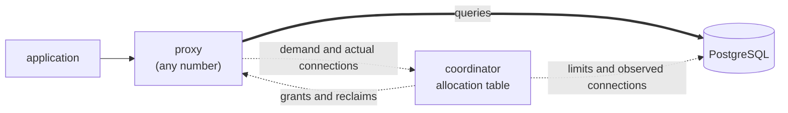

# PgSteward

**A PostgreSQL connection pooler whose pool size is a budget, not a setting.**

PgSteward never lets the connections it opens exceed what the database can take, and it moves that capacity to wherever the demand is. You never write a pool size into a config file, so adding proxies or tenants never means recalculating one.

> **Status: early, not production-ready.** A single node already pools in session and transaction mode, speaks SCRAM and TLS on both sides, and performs on par with PgBouncer. Running many proxies against one shared budget is the next stage and is under construction.

## Why

### The pool size is the wrong knob

Every self-hosted PostgreSQL pooler, from PgBouncer in 2007 to PgCat and Supavisor today, treats the pool size as a static per-process value in a config file. The number of connections a pooler actually opens moves within that limit, but the limit itself is fixed. Someone works it out by hand, and it is only correct for the deployment it was calculated for.

That breaks in three ways once the deployment starts to change.

**Scaling out multiplies connections.** Suppose `max_connections` leaves room for 100 and you run 4 poolers. You write `default_pool_size = 25`. When the poolers autoscale to 8, alongside the application or for redundancy, the database can now receive 200 connections, and the excess is refused with an error. To stay safe you edit every pooler down to 12, which wastes capacity whenever load is uneven:

| | 4 conventional poolers | 4 PgSteward proxies |
|---|---|---|
| What you configure | `default_pool_size = 25` per process | nothing: the total budget of 100 is derived from the database |
| Proxy 1, demand 60 | capped at 25, 35 clients wait | granted 60 |
| Proxies 2–4, demand 10 each | 10 busy, 15 idle on each | granted 10 each |
| Scale to 8 | up to 200 connections, unless you rewrite the value to 12 | no change, still at most 100 |

A budget split by the number of instances cannot even express 100 connections across 200 proxies (0.5 each). A budget handed out on demand can.

**There is no cluster-wide cap.** PgBouncer can cap a database or a user but not the server as a whole ([pgbouncer#103](https://github.com/pgbouncer/pgbouncer/issues/103)). Set the per-pool values high and a burst exceeds `max_connections`. Set them low and connections go unused while clients queue.

**Under contention, first come first served.** With many tenants sharing one database, a nightly batch or a promotion spike can take every connection. Holding seconds-long transactions, it pushes millisecond API calls into second-long waits, and with identical load one user can starve the others completely ([pgbouncer#131](https://github.com/pgbouncer/pgbouncer/issues/131)). Fixed per-tenant pools prevent this but leave capacity idle, and shared pools keep everything busy but guarantee no one a floor. Meanwhile pools for tenants that have gone quiet accumulate and cannot be cleaned up individually ([pgbouncer#1085](https://github.com/pgbouncer/pgbouncer/issues/1085)).

These problems get worse as databases are created and managed by automation rather than by people. Nobody is left to revisit those numbers.

### What PgSteward does instead

PgSteward keeps the allocation in one ledger and hands out **connection slots**, each a right to open one database connection, according to demand.

- **The total budget is derived, never configured.** For each instance it is `max_connections` minus the reserved connections, the peak of connections that other clients hold, and a safety margin. There is no `pool_size` or `budget` key; the config parser rejects both.
- **Tenants declare intent, not sizes.** A tenant (a `user × database` pair) has a `min` (a guaranteed floor), a `max`, and a `weight`. Floors are reserved first. The rest goes to tenants with demand, using weighted max-min fairness, so no slot sits idle while someone is waiting.
- **No demand, no pool.** A registered tenant gets nothing until a client actually connects, so the number of pools grows with the number of tenants in use, not the number registered.
- **No extra hop.** The component that decides is not on the query path. Queries go client → proxy → PostgreSQL and nothing else.

For example, with a budget of 100, `web` guaranteed 30 and `worker` guaranteed 10, and demands of 60 and 90, the floors are met first. The remaining 60 are then shared fairly, so `web` gets its full 60 and `worker` gets 40. During the day, when `worker` is quiet, nearly all 100 go to `web`. When the batch starts, slots move back.

## Quick start

You need a Rust toolchain (stable), Docker, and `psql`.

**1. Start PostgreSQL and create a tenant.**

```bash
docker run -d --name pgsteward-pg -e POSTGRES_PASSWORD=postgres -p 54329:5432 postgres:16

export PGPASSWORD=postgres
psql -h 127.0.0.1 -p 54329 -U postgres \
  -c "CREATE ROLE app LOGIN PASSWORD 'secret'" \
  -c "CREATE DATABASE app OWNER app"

# PgSteward authenticates clients with the SCRAM verifier PostgreSQL stores,
# so no client password is written to its config.
psql -h 127.0.0.1 -p 54329 -U postgres -tA \
  -c "SELECT rolpassword FROM pg_authid WHERE rolname = 'app'"
```

**2. Write the two config files.** Paste the verifier printed above into `node.toml`.

`node.toml`: settings local to this node.

```toml
[node]
role = "proxy"
listen = "127.0.0.1:6432"
coordinator = "127.0.0.1:7432"
max_client_connections = 100
metrics_listen = "127.0.0.1:9187"

# The login used to read max_connections and count other clients' connections
# (needs pg_monitor or superuser).
[monitor]
user = "postgres"

# Passwords this node uses when it opens connections to PostgreSQL.
[server.postgres]
password = "postgres"

[server.app]
password = "secret"

# Users this node accepts, by SCRAM verifier.
[client.app]
verifier = "SCRAM-SHA-256$4096:..."
```

`cluster.toml`: instances and tenant policy, shared by the whole cluster.

```toml
[cluster]
pool_mode = "transaction"
grant_ttl = "10s"
arbitration_interval = "100ms"

[[instance]]
name = "127.0.0.1:54329"

[tenant.app]
instances = ["127.0.0.1:54329"]
min = 2
max = 10
```

Tenant keys are matched from most to least specific: `user@database`, then `user`, then `*`.

**3. Run it.**

```bash
cargo build --release -p pgsteward-node
RUST_LOG=info ./target/release/pgsteward --config node.toml --cluster cluster.toml
```

The log shows how the budget was derived:

```
derived the total budget instance=127.0.0.1:54329 budget=81 = max_connections 100 - superuser_reserved_connections 3 - reserved_connections 0 - foreign peak 1 - margin 15
```

**4. Connect through it.**

```bash
PGPASSWORD=secret psql -h 127.0.0.1 -p 6432 -U app -d app -c "SELECT 1"
```

Connect to the reserved database `pgsteward` to reach the admin console:

```bash
PGPASSWORD=secret psql -h 127.0.0.1 -p 6432 -U app -d pgsteward -c "SHOW POOLS" -c "SHOW BUDGET"
```

The console accepts `SHOW POOLS | BUDGET | CLIENTS | SERVERS | INSTANCES | CONFIG`, `RELOAD`, `PAUSE`, `RESUME`, `SET INSTANCE <name> margin = <n>`, and `SET TENANT <name> min = <n>, max = <n>, weight = <n>`. Prometheus metrics are served at `http://127.0.0.1:9187/metrics`.

`SIGTERM` or Ctrl-C stops the node gracefully: in-flight transactions finish, and the node returns its slots before it exits.

## Architecture

### Coordinator decides, proxies realize



PgSteward has two roles, both built into the same binary.

- The **coordinator** computes the desired state. This is an *allocation table*: instance × tenant × proxy → number of slots, recomputed from the total budget, the tenant policies, and the demand each proxy reports.
- A **proxy** speaks the wire protocol, accepts client connections, and *converges* its real database connections to what it has been granted. A proxy never grows or shrinks its slots on its own. It reports demand and follows grants.

The invariant that outranks availability and throughput: **for each instance, the number of connections PgSteward holds on the database never exceeds that instance's total budget.**

Today a node runs the proxy and an in-process coordinator together. Because the proxy talks to the coordinator only through a narrow `GrantChannel` interface (subscribe to grants, report demand and actual connections), the distributed coordinator can replace the in-process one without changing the proxy. The `role` and `coordinator` keys in `node.toml` are validated but not yet acted on.

### Crates

Dependencies flow strictly downward.

| Crate | Responsibility |
|---|---|
| `pgsteward-protocol` | Wire protocol v3 framing, message types, startup handling, the ReadyForQuery state machine, the admin console grammar. No I/O, no clocks. |
| `pgsteward-sched` | The allocation algorithm: total budget, policies and demand go in, the desired grants come out. A pure function. |
| `pgsteward-core` | Sessions, server connections, authentication, TLS, the pool and wait queue, reset, cancellation, the allocation table and the in-process coordinator, and the `rt` runtime abstraction. |
| `pgsteward-node` | The `pgsteward` binary: configuration, serving, admin console, metrics, signal handling. |
| `tests/harness` | Fake PostgreSQL, a `pg_stat_activity` observer, and the shared connection-cap assertion. |
| `tests/sim`, `tests/integration`, `bench` | Deterministic simulation, tests against real PostgreSQL 16, and the PgBouncer comparison. |

### Design decisions worth knowing

- **Returning a connection is decided in one place.** `ReadyTracker::may_release()` allows a server connection back into the pool only when no ReadyForQuery is outstanding, no extended-query window (Parse through Sync) is open, and the transaction status is idle. Before reuse, the connection is reset with `DISCARD ALL`, and it is only returned if that succeeds.
- **Cancel keys are issued by PgSteward.** Handing a client the database's own key would let it cancel the next client's query on the same connection.
- **Unsupported features fail loudly.** In transaction mode, a `Bind` to a prepared statement that this connection never saw is refused with SQLSTATE 26000, and `LISTEN` is refused, rather than misbehaving silently.
- **Time and I/O go through `rt`.** Code never calls `tokio::spawn`, `tokio::time`, `tokio::net` or `Instant` directly. It is handed a `Clock` / `Spawner` / `Net` value (`TokioRuntime` or `TurmoilRuntime`), so the same node runs unchanged inside the [turmoil](https://github.com/tokio-rs/turmoil) deterministic simulator.
- **The cap is checked, not assumed.** `CapMonitor` polls the connection count for the whole test, both on a real PostgreSQL (`pg_stat_activity`) and in simulation. It fails on a single sample over the budget, and on any failed observation, because an unobserved interval proves nothing.

### Performance

With `pgbench -c 200 -j 8 -T 60` against PostgreSQL 16, PgSteward with a derived budget of 20 ran at 100.7% of the throughput of PgBouncer 1.25.2 with `default_pool_size = 20` (median of 5 alternating runs, release build). With a 60-second hysteresis before releasing slots, connection churn under bursty load dropped from about 340 re-established connections per 15 seconds to zero.

## Roadmap

- [x] Single-node pooler: session and transaction mode, SCRAM and TLS on both sides, cancellation, reset, admin console, metrics, graceful shutdown
- [x] Derived total budget, per-tenant min / max / weight, weighted max-min fair allocation
- [x] Deterministic cluster simulation harness with seeded faults, clock skew, and recovery-time measurement
- [ ] Shared coordinator across many proxies: grant requests, demand reports, reclaiming slots from one proxy to give to another
- [ ] Behavior when the coordinator is unreachable, and failover
- [ ] Cancellation forwarded across proxies, rolling restarts
- [ ] Chaos testing with published seeds and measured targets

The step-by-step implementation plan, with what each step delivered, is in [`docs/plan.md`](docs/plan.md) (in Japanese).

## Development

### Setup

- **Rust**, stable channel. `rust-toolchain.toml` selects it and adds `rustfmt` and `clippy`. CI uses the latest stable, so run `rustup update stable` before checking locally.
- **Docker**, for the integration tests. [testcontainers](https://github.com/testcontainers/testcontainers-rs) starts PostgreSQL 16 for you.
- **cargo-deny**, plus **cargo-audit** if you want to run every CI check: `cargo install cargo-deny cargo-audit`.

```bash
git clone https://github.com/donkomura/PgSteward.git
cd PgSteward
cargo build --workspace
```

### Tests

```bash
cargo test --workspace --all-features --exclude pgsteward-integration-tests   # unit, property and simulation tests
cargo test -p pgsteward-sim-tests --all-features                              # turmoil simulation only
cargo test -p pgsteward-integration-tests                                     # real PostgreSQL 16, needs Docker
cargo test -p pgsteward-protocol --test ready flush_without_sync              # one test: crate, test file, test name
```

The turmoil runtime in `pgsteward-core` is behind the `turmoil` feature, so pass `--all-features` whenever simulation code is involved.

### Before you push

Run what CI runs:

```bash
cargo fmt --all --check
RUSTFLAGS="-D warnings" cargo clippy --workspace --all-features --all-targets   # clippy::pedantic is on
cargo deny check
cargo audit
cargo test --workspace --all-features --exclude pgsteward-sim-tests --exclude pgsteward-integration-tests
cargo test -p pgsteward-sim-tests --all-features
cargo test -p pgsteward-integration-tests
```

### Conventions

- Each change is one small, self-contained step. Write the tests first, confirm they fail, then implement without changing them.
- Everything in the repository (code, docs, commit messages, error messages) is in English.
- Every config struct is `deny_unknown_fields`.

## License

[MIT](LICENSE)
